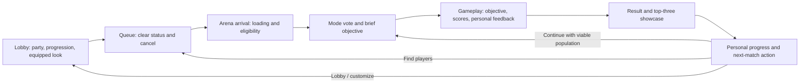

# Arena experience redesign

## Brief and authority

Build a coherent lobby → arena → result → next match loop that makes rules legible, play satisfying, accomplishments visible, and cosmetic purchases desirable. Preserve the existing Fall Guys-inspired palette, chunky shapes, typography and movement. Extend the current React, deterministic simulation, profile, cosmetics, party and teleport owners; do not introduce parallel gameplay or reward state.

The user authorizes implementation and Studio asset work after planning, including justified departures from the supplied mode design where it would harm the gameplay loop or monetization. Exactly one new pass may be implemented: **1970065084**. Its icon remains a stub, and Robux prices are always client Marketplace product information. Mobile targets landscape; existing portrait architecture is preserved.

**Final mode direction (2026-09-06):** the user replaced the missing-document requirement with “keep the game modes as is actually but refine them heavily.” The existing FFA/TDM rules and disabled Infection entry are the source for this implementation. The decisions below refine fairness, lifecycle and presentation without inventing a replacement mode spec.

Confirmed CoreGui decision: replace the Roblox player list, health/backpack HUD and overhead labels; retain Roblox chat and pause/report controls. Do not remove the platform menu or silently replace communication features.

## Current findings that drive the redesign

| Current behavior | Player impact | Planned response |
|---|---|---|
| Match HUD renders a single dark text panel; team scores are hardcoded to Red/Blue. | Weak hierarchy; future mode state cannot be understood reliably from the HUD. | Mode-aware objective, clock and score components driven by authoritative structured projections. |
| Default Roblox gameplay UI and overhead labels remain active. | Competing presentation and potentially irrelevant health/backpack information. | One arena client owner disables only replaced surfaces and restores prior values on cleanup. |
| Results uses three equally prominent information panels and repeats a large logo. | Players scan several areas before understanding their result and next step. | Podium/result hero, compact personal progress, secondary full scoreboard, stable action footer. |
| Results action-button nine-slices visibly cut off the right edge. | Broken shapes undermine the otherwise deliberate visual style. | Reuse the existing interaction primitive with a simple rounded surface/shadow; retain authored icons and decorative images where they scale correctly. |
| Results lasts 12 seconds, and matched parties return to the lobby unless the leader chooses replay. | Repeated decisions and teleports interrupt momentum. | Clearly communicate the next destination, simplify replay, and recover low-population sessions through the existing lobby matchmaker. |
| Replay retains players in the same reserved server without population recovery. | A shrinking group can be left in an uninteresting match. | Evaluate playable population at the reset boundary and offer/route an explicit find-match path through the current return/party owners. |
| PostMatchClient waits on an unbounded RemoteFunction call. | A stalled request can leave the principal action pending for the rest of Results. | Use the bounded ClientRequest path, result generations and authoritative status revisions. |
| FFA tie copy names the first sorted score entry as the winner even when no winner was declared. | A tied player can be shown as a winner without an authoritative win. | Separate rank ordering, tied placement and actual winner semantics. |
| Results has no production podium or cosmetic celebration selection. | Earned placement has little social visibility; equipment purchases lack a strong display moment. | Show real contestant appearances and equipment, with equal podium eligibility and optional cosmetic presentation. |
| Match music is configured to zero volume. | Gameplay has less energy than the available audio assets support. | Audition the authored music/cues, establish a restrained mix and respect player volume/reduced-motion preferences. |

The existing persistence remediation remains intact. Pending rewards must stay pending in the UI until the actual award owner supplies a committed summary. No client celebration grants currency or invents an accomplishment.

## Player journey

Every transition has one visible status and an explicit recovery route. Party-wide decisions remain leader-owned; members can leave individually without silently moving the party. A disconnected leader is replaced through the existing effective-leader rule. Reward recovery, rejected admission and loading failures must never masquerade as ordinary defeat or a stalled vote.

## Work sequence

### 1. Reconcile mode rules and result semantics

1. Use the existing mode definitions under the user's final direction. Map their rules to config, pure sim, mode hooks, server consequences, HUD and results.
2. Record retained rules and justified refinements in the final decision table, including their owners and validation.
3. Centralize shared mode metadata and objective wording. Keep numerical tunables in config; compose current rules once at match preparation so live overrides cannot change a match halfway through.
4. Cover scoring, ties, win/lose conditions, time cap, roster changes, respawns/conversions, minimum population, join-in-progress, team balance and spawn protection. Keep combat outcomes authoritative and pure simulation deterministic.
5. Derive standings and podium candidates from the mode's actual scoring semantics. Team victory and individual recognition are distinct. A stable display tie-break must not fabricate an untied placement or change a winner.
6. Update existing tests, vote descriptions, onboarding/help wording, live-config allowlist and documentation to agree with the adopted spec. Preserve old profile and product identities.

**Acceptance:** every adopted rule has a config/sim/server test or an explicit Studio scenario; UI names the same objective and outcome as the server. The final mode direction above supersedes the missing-document dependency.

### 2. Establish the arena presentation foundation

1. Add a small arena presentation config using the existing cyan, pink, yellow, purple and charcoal colors, existing fonts, edge treatment, spacing and motion timings. Reuse ResponsiveText, AnimatedButton, Motion, safe-area hooks and number formatting.
2. Add only the genuinely shared surfaces needed for HUD, scoreboard and results: rounded panel with offset shadow; section/title text; compact statistic; primary/secondary action. Repair broken slices by using geometry for flexible surfaces, not another arbitrary SliceCenter.
3. Add an arena CoreGui lifecycle owner. Disable replaced CoreGui types after initialization with bounded retries, suppress native Humanoid name/health labels on new characters, and restore captured values on teardown. Preserve chat and pause/report controls. Custom scoreboard starts closed.
4. Treat screen safe areas, full-screen backgrounds and interaction insets separately. Reserve touch controls and at least 44-pixel actions. Long display names truncate in a controlled way; numeric scores remain readable.
5. Make module cleanup explicit: one input binding per action, no abandoned selection ownership, no unlimited preview/model instances, no render loop per label.

**Acceptance:** no competing native gameplay HUD; respawn does not restore it; menu/chat focus works; no page overlaps combat touch regions; desktop/tablet/short and notched landscape phones retain legible controls.

### 3. Rebuild gameplay information and feedback

1. Replace the current monolithic text HUD with a compact objective header. Put the clock centrally, primary opposing scores or personal/leader progress beside it, and the objective immediately beneath. Mode-specific counters come from structured state rather than mode-name guesses.
2. Build the custom scoreboard from replicated authoritative scores and current roster. Provide keyboard, controller and touch access, local-player emphasis, team grouping where appropriate, tied ranks and clear unavailable/late-join states. Close it on phase transitions and when higher-priority UI takes ownership.
3. Add a short start banner that teaches the active objective, then collapses into the HUD. Countdown urgency appears only near the deadline and has a restrained cue; it does not obscure aiming.
4. Consolidate elimination, catch, scoring and respawn messages so each meaningful outcome produces one readable visual/audio response. Reuse EventDedup. Distinguish a personal success, being eliminated, the next respawn and a match outcome.
5. Explain eliminated/spectating/next-round/reward-recovery states accurately. If the mode spec calls for spectating, implement bounded target cycling and target-departure fallback through the camera adapter rather than leaving an immobile freefall view.
6. Add user-configurable audio and reduced-motion behavior to the new presentation. Gameplay audibility takes priority over UI jingles.

**Acceptance:** within a glance, players can answer what wins, who leads, how long remains and what happens to them next. No client presentation calculates a hit, awards score or supplies a trusted winner.

### 4. Replace the post-match composition

1. Preserve PostMatchService as the packet/action owner and PostMatchClient as its local adapter. Extend the existing result contract for bounded podium data and presentation selections; validate the new fields and handle an older/missing optional payload cleanly.
2. Structure Results as a short result reveal followed by an interactive showcase. The hero shows the actual outcome and up to three earned placements. Place first in the center, second left and third right; small rosters leave intentional open space rather than duplicate avatars.
3. Render the game's authored CharacterRig with the contestants' actual equipped color/weapon cosmetics. Reuse shared cosmetic construction and extract reusable posing/grip preparation only where duplication is real. Defer preparation outside React render/effect commits, cap rigs at three, and clean them up on result change/exit.
4. Animate a brief podium entrance/celebration with existing assets or authored Studio parts. The free presentation remains complete and celebratory. Missing optional cosmetics fall back to the category default, not a blank rig. Required assets retain assertions.
5. Keep personal progress in a compact card or strip: actual placement/contribution, eliminations/catches where relevant, earned XP and Bonks, and season movement. Pending and failed/recovering rewards remain explicit. More detailed standings are available without replacing the hero with a spreadsheet of equal-sized panels.
6. Keep the footer in a stable location from the first interactive frame. Use short labels and destination-specific countdowns. Party members see the leader's state and an individual leave path. Modal focus follows enabled actions and respects higher-priority dialogs.
7. Use one bounded audio/motion sequence keyed by result ID; a later reward update does not restart applause, podium motion or action state. Reduced Motion presents the same information immediately.
8. Fix all result images/slices and audit pending, empty, tie, win/loss, small roster, long name, leader/member and teleport-failure states in stories and live Studio.

**Acceptance:** the result, personal earnings and next action are immediately distinguishable. No duplicated winner, wrong tie copy, stretched button edges, unreadable footer or replay request that silently hangs.

### 5. Make repeat play and return coherent

1. Refine continuation under the user's existing-mode direction. Prefer a clearly announced continuation flow with an easy Lobby exit over repeatedly ejecting engaged parties. Any default change is documented and made visible before the countdown expires.
2. Preserve grouped teleports, effective-leader replacement and individual party separation. Use existing ArenaReturnService and PartyService; do not build a second matchmaker inside Results.
3. Resolve low population at a match boundary. If continuation cannot produce a valid match, offer an explicit find-match path; if an automatic queue handoff is adopted, encode it in the authenticated return payload and let the lobby party owner execute it once after return reconciliation.
4. Bound requests and retries. Do not expose an accepted replay state before the server accepts it, strand a party behind a vanished leader, or erase an in-flight action when a reward summary arrives.
5. Audit late result delivery, repeated status events, old result IDs, server-day rollover, profile recovery and teleport failures. Keep Retry/Stay available through the existing coordinator.
6. Audit the lobby from first join through queue, arena arrival, match, results, repeat and return. Align terminology, sound/motion ownership and menu entry points across the two places.

**Acceptance:** a solo player, party leader and party member each have a clear, tested route into another valid match or back to the lobby; no silent single-player competitive loop or party split introduced by replay.

### 6. Implement exactly one new pass: Showtime

**Product concept:** a permanent cosmetic celebration collection. Owners choose between distinct show-off styles for their post-match character/result card, with the celebration's accent/confetti derived from the equipped emote. Outcome/team colors retain their gameplay meaning. Showcase styles appear on earned podium placements; an owner's own result card can preview/use the style even when they do not finish in the top three. It does not alter placement, stage time allotted to winners, matchmaking, visibility during combat, input, weapons, speed, cooldown, rewards or progression.

**Why it is a distinct offer:** existing passes sell a single impact effect, an impact collection or earn-rate boosts. Showtime sells repeatable social expression at the end of a match. It makes the user's selected look visible in a moment players already care about and provides a benefit that does not require winning every round. It is not a paid podium slot.

1. Bind the pass to **1970065084**. Read-only Marketplace inspection identifies the current stub as `new`, off sale. Keep the stub/existing placeholder icon and provide final product title/description for the user's later rename.
2. Populate the existing EmoteAssets slot and EMOTES inventory tab with a complete free victory default and three materially different paid victory emotes. Do not add a parallel celebration category or separate equip system. Use fixed curated styles, not unfiltered player-authored text or uploaded effects. Keep cosmetic ownership/equipping in CosmeticsService and platform ownership in GamePassService/EntitlementService.
3. Make styles visibly different through pose, color composition and a short confetti/burst treatment while preserving equal information and recognition for nonowners. Reuse the current effect/motion framework and authored assets; cosmetic geometry is isolated from gameplay and cleaned up.
4. Deliver all pass styles idempotently, reconcile existing ownership on join/purchase, retry partial grants, and accept already-owned items without duplicate currency. The existing cosmetic profile schema already carries EmoteAssets; add its free catalog default without creating new persisted state or changing old inventory or balances.
5. Expose a working locker selector and an explicit style preview. Merchandise the one pass through the existing shop card/detail flow and contextual discovery from the showcase; avoid automatic purchase prompts or a paid action replacing the primary replay button.
6. Fetch the player's live Marketplace price and availability. Missing/off-sale metadata cannot fabricate a price or prompt. No configured Robux amount, price ladder, artificial sale or recurring payment is introduced.
7. Track preview → explicit prompt → fulfilled grant/equip using the current analytics owner. Any revenue/retention benefit is a hypothesis to evaluate, not a promised outcome. Launch pricing and regional optimization belong in Creator Dashboard.

**Acceptance:** every advertised cosmetic works, persists and can be previewed/equipped in both places; the pass grants once and has no competitive advantage; nonowners retain the full free result experience; only this one new product identity is added.

### 7. Verify, document and hand off

- Pure specs: mode rules, ordering/ties/podium projection, result parsing, continuation decisions, HUD/scoreboard derivation, responsive budgets, pass grants/catalog invariants, and return-payload compatibility.
- Engine specs: replicated projections, CoreGui/character lifecycle where suitable, protected post-match requests, ownership/partial-grant retries, authored rig/assets and bounded preview cleanup.
- Studio: mode start/end, custom HUD, scoreboard input/focus, eliminated/respawn flow, win/loss/tie/pending Results, two/three/full podiums, style previews, real player appearance, touch landscape, tablet and desktop, long names, reduced motion and repeated cleanup.
- Full journey: queue and cancel, arrival/loading, vote, each supported mode, repeat, low population, party leave/leader disconnect, return failure/retry/stay, reward arrival after Results, pass ownership reconciliation.
- Repository: headless tests, both place lint/format checks, shared lint/format, diff checks. Preserve the prior remediation baseline and user edits.
- Release gates: platform sale/rename/icon changes, actual regional/billing accounts, saved-place cloud suites and any multiplayer/hardware checks the available environment cannot substantiate. Record executed results separately from planned/manual acceptance.

## Architecture boundaries

| Concern | Owner |
|---|---|
| Mode outcome, score, roster, phase and spawn consequences | MatchSim/mode hooks + MatchService |
| Exact match award and persistence | PlayerData/MatchAwardService with ProgressionService projection |
| Result payload, group action validation and revisions | PostMatchService |
| Return/retry/group retention | ArenaReturnService; authenticated lobby return handled by PartyService |
| Live UI derivation and result request lifecycle | MatchHUDClient / PostMatchClient |
| Native UI suppression and replaced character labels | One arena client lifecycle module |
| Cosmetic catalog, ownership, equip projection | Cosmetics config + CosmeticsService |
| Pass ownership and reconciliation | Existing GamePassService / EntitlementService |
| Rendering, preview preparation, motion and cues | Small shared presentation components/services; no gameplay authority |
| Purchase price and prompt | Existing client ShopClient + MarketplaceService |
| Event vocabulary and analytics transport | Existing Analytics config/service |

## Measurement and decision standard

Prioritize match completion, second-match participation, time from result to active play, party continuation, reward comprehension and successful cosmetic fulfillment. Inspect D1 retention and average session time alongside pass preview-to-purchase conversion and revenue per paying user. Segment by new/existing player, device, party size, mode and ownership. Do not optimize for additional screen time that merely comes from waiting, stalled teleports or forced animations.

Roblox's own guidance prioritizes retention/engagement and getting players into meaningful play quickly; it also provides distinct payer conversion and revenue metrics. These support the measurement framework, not a guarantee that any particular visual treatment increases revenue. Sources: [analytics](https://create.roblox.com/docs/production/analytics), [engagement](https://create.roblox.com/docs/production/analytics/engagement), [monetization](https://create.roblox.com/docs/production/monetization), [dynamic pricing checks](https://create.roblox.com/docs/production/monetization/price-optimization).

## Execution ledger

- [x] Preserve source baseline at `/tmp/ouch-arena-experience-baseline`.
- [x] Inspect current owners, mode configuration, arena/lobby assets and result UI.
- [x] Reproduce broken result button slicing in Studio.
- [x] Confirm CoreGui scope and inspect new pass identity without changing sale settings.
- [x] Resolve mode authority: user directed refinement of the existing modes.
- [x] Finalize the mode decision table and continuation policy below.
- [x] Implement presentation foundation and native UI replacement.
- [x] Implement gameplay HUD, scoreboard, start objective, teammate identification and feedback for the current enabled modes.
- [x] Implement podium/result/progression/action redesign.
- [x] Implement repeat/return recovery.
- [x] Implement Showtime grants, cosmetics, preview, equip and merchandising through the existing systems.
- [x] Complete available integrated Studio QA, final evidence and release handoff; retain platform and multiplayer acceptance as explicit release gates.

## Implemented behavior and evidence

The implementation now includes the existing-mode refinements and repeat recovery; real multiplayer/platform release checks are recorded separately below. [Showtime's product handoff](showtime-pass.md) records its complete path, exact cosmetic identities, asset dependency, verification and Dashboard setup.

- **Arena information:** structured objective/clock/scores, a server-counted start banner, local rank/team identity, respawn/recovery text, and a custom scrollable scoreboard using Tab, controller Select and a touch-sized Scores action. Visible living teammates receive occluded world labels; opponents are not exposed through walls. The native player list, health, backpack and Humanoid labels are suppressed by one lifecycle owner. Studio explicitly reported Chat enabled and the three replaced CoreGui types disabled.
- **Results:** top-three earned appearances, stable tie placement, center-first podium ordering, captured character color/emote and desktop weapon previews, personal committed XP/Bonks/progression, secondary standings, and stable action buttons without the broken slices. Default empty equip projections parse correctly. Partial/older optional payloads remain compatible. A live server-generated solo result rendered with the real free character, equipment, earnings and replay footer; three-person stories rendered on desktop, short landscape phone and landscape tablet.
- **Repeat clarity:** the existing return owner projects `nextDestination` into status packets. The footer names Arena versus Lobby from that projection, including direct joins and party retention. It does not guess from the button label. A native Studio click on Play Again returned `state=PlayAgain`, revision 2 and destination Arena; the same session subsequently reached another Active round. The final default continuation and low-population handoff now replace that interim policy; see the final decisions below.
- **Request/focus lifecycle:** post-match and cosmetic-equip requests use the bounded shared client request path. Phase cleanup restores selection only to visible controls in an enabled, mounted screen, fixing an invalid-selected-object warning reproduced in Studio. Late reward updates do not restart the result cue or reset an accepted action.
- **Audio:** match music now uses the authored playlist at a restrained 0.12 base volume. A start cue and last-five-seconds cues use existing audio assets and the current ClientAudio/settings owner; the existing result whistle remains the only result audio. Studio observed five final-second sounds, one result whistle and one subsequent start cue through a timed round. Pure tests cover duplicate/skipped/increasing clock projections. Headphone/speaker mix quality still needs a listening pass; this tooling verified routing/counts, not subjective sound quality.
- **Showtime:** three distinct paid styles plus the free wave, existing Backpack selection, real Marketplace-only pricing, verified ownership/partial-grant retries and notifications, and existing analytics vocabulary. The results card gives a quiet Shop/Backpack discovery hint; it never opens a prompt during the result timer. The existing offer and equip owners remain the only state owners.

### Additional defects found through Studio

1. **Loading waited for its own streamed-out origin marker.** The server had MapOrigin while the client could wait forever before requesting streaming around it. ArenaService now projects the authored position on the arena Folder; loading/vote camera consume that projection. Subsequent Play sessions completed the loading gate without the prior infinite-yield warning. The preview rig is also included in the existing bounded critical preload manifest.
2. **The shared safe-area helper discarded usable landscape height.** GuiService inset rectangles share a coordinate space; clamping the negative full-screen origin before translating lost 58 pixels on the tested phone. The pure helper now intersects device/parent rectangles before translating to the parent's origin. Two regression cases pin full-screen and notched/CoreGui layouts. The API contract is documented by [GuiService](https://create.roblox.com/docs/reference/engine/classes/GuiService).
3. **The authored preview rig was incomplete and its constraints fought manual poses.** Both places were missing LeftFoot. It was repaired through Studio; preview clones now strip saved physics/animation controllers before using the attachment graph. Exact asset requirements are in [Studio setup](dodgeball-studio-setup.md#victory-emote-preview-rig). The authored rig and live character retain their controllers.
4. **Per-preview update loops were avoidable.** Inventory and celebration previews now share a visible-only 30 Hz scheduler. A live probe counted 10 visible updates, then remained at 10 while hidden and after unregistering. Required asset preparation is deferred out of React commits; cleanup cancels unfinished preparation and destroys clones.

### Verification record

- Final headless suite: **690 tests, 0 failures**, covering the pass/pose/equip invariants, result ties/podium/parser, inset geometry, HUD/audio transitions, mode viability, NoContest and return queue policy.
- Final arena Studio suite: **196 passed, 0 failed, 0 skipped** with the gameplay entry point temporarily disabled for isolation and then restored. This runs every in-place spec except `Assets/Environment.spec`, whose cloud-only assertions require zero players and a stopped server context. It does not replace the saved-place cloud run. Injected platform failures in service specs are expected warnings.
- Final full lobby Studio suite: **40 passed, 0 failed, 0 skipped**, including return-queue integration, teleport preflight/retry, authored scene, rig and actual landscape layout budgets. Shop style switching and fixture-only Backpack equipping were also exercised without a purchase or test ownership on the real profile.
- Shared, arena and lobby Selene checks: **0 errors and 0 warnings**. Both explicit-project Rojo builds passed. Formatting and diff checks passed after the final formatting correction.
- Native CoreGui inspection, actual results/replay request, short/notched landscape inventory, short landscape HUD/results and tablet podium checks were performed. These are single-client Studio checks, not proof of party teleports or network fairness.

### Release gates

1. The user resolved mode authority by directing refinement of the existing modes. Implementation and available Studio verification are complete; the remaining platform operations are listed below.
2. Run an integrated multi-client journey with real parties: queue/cancel, arrival, vote, each adopted mode, leader departure, replay viability, grouped return, retry/stay and another queued match. Validate latency and mobile hardware separately.
3. Save the authored changes through Studio and include the saved assets in the place deployment; run each place's complete saved-place cloud suite. The open documents contain the rig repair; no repository tool edited a `.rbxl` or the user's asset export.
4. Rename/enable the off-sale stub and set its actual price/icon in Dashboard, then verify billing, regional displayed-versus-prompted prices and cross-server entitlement reconciliation using appropriate accounts. No sale setting or purchase was changed during this work.
5. Finish listening/device-accessibility/performance acceptance with several simultaneous players and effect-heavy combat. The code obeys existing settings and bounded preview scheduling, but this is not a measured device performance or retention/conversion result.

Both Studios were returned to Edit mode with their normal viewport. Temporary QA scripts, clones and GUI roots were removed by stopping Play; the authored LeftFoot remains in both places. No place was published and the pass remains off sale.

## Final mode and repeat decisions — 2026-09-06

| Concern | Implemented behavior | Player/economy justification |
|---|---|---|
| Existing modes | FFA and TDM remain enabled; Infection remains explicitly disabled. FFA stays first to 15 / 300 seconds; TDM stays first to 40 / 360 seconds. | Preserve the established combat/mode identity. There is no playtest evidence supporting an arbitrary score or time-cap retune. |
| Match population | Production FFA/TDM need at least two players. TDM additionally needs two independent parties/entrants before voting or starting. | No empty opposing team or solo competitive reward loop; parties remain together. |
| Testing | Studio and the existing authorized developer solo path can still start practice rounds. Practice rules are captured for that round only. | Preserve iteration speed without lowering production eligibility. |
| Ballot departures | Resolve only still-viable options that were actually on the ballot; cancel/reopen when none survives. Revalidate at match start. | A departing party cannot leave an impossible TDM result queued indefinitely. |
| Team assignment | Keep the existing minimum-imbalance party partition, with ordered traversal for deterministic assignment. | Preserve friends and prevent unstable assignment from table iteration order. |
| Lost opponents | Eight-second authoritative recovery deadline, canceled if a valid roster returns. Otherwise end as NoContest. Team viability checks actual occupied teams. | Avoid several minutes of empty gameplay; do not award a win because opponents disconnected. |
| No-contest rewards | Preserve already-earned combat progress. Grant no match-completion XP/Bonks, win, match-played count, or completed-match quest progress. | No fabricated success or disconnect-based completion farming. |
| Spawn protection | Existing protection duration remains; an accepted dodgeball windup/hammer swing ends it. HUD explains this. | Protection helps re-entry without allowing protected attacks. |
| Scores and recognition | Preserve departed contestants' captured elimination contribution in final standings. Winner authority remains separate. NoContest has no podium winner. | Accomplishments do not disappear when a player disconnects; display ordering never manufactures a win. |
| Repeat default | Viable parties remain for the next vote automatically. Results names the destination/countdown and retains an explicit Lobby exit. | Fewer repeated clicks and teleports interrupting an engaged group. |
| Population recovery | “Find players” is a leader-owned, explicit grouped return with optional authenticated `queueOnArrival` intent. The existing lobby owner queues once after all expected members arrive locally. | Reuse the real matchmaker; do not pretend an empty reserved server can backfill itself. |
| Return reconciliation | One bounded pending intent on the party record, 20-second expiry, cancellation, duplicate-arrival guard and source-party/match validation. Membership changes cancel the pending handoff. | Late arrivals cannot requeue a canceled party or move only part of it unexpectedly. |
| Queue floor | The existing relaxation ladder reaches two players after 30 seconds, rather than one. Developer solo remains separate. | Prevent recovery from immediately sending a solo player back to another empty arena. |
| Reward/teleport failure | The shared retry coordinator performs the reward preflight on each attempt. Failed/pending saves expose Retry/Stay, with reward-specific copy. | Results expiry cannot hide a pending save or bypass it on retry. |

The new `queueOnArrival` field is optional in return schema 1. Older returns remain ordinary lobby returns. `FindMatch` extends the existing protected PostMatchRequest action set; legacy replay/cancel actions remain accepted. No new remote, matchmaking queue or player-profile field was added.

## Final integrated QA additions

- Live Studio confirmed automatic Results → next vote → another Active round without clicking replay.
- A live opponent-loss scenario produced `NoContest`, no winner, committed zero completion XP/Bonks, `canReplay=false`, and the Find Players/Lobby footer.
- Studio's real unsupported-teleport failure produced Try Again/Stay; a native Stay click restored round eligibility.
- Ten new isolated service checks cover return grouping, leader cancellation, duplicate arrivals, expiration, ban checks, enqueue rollback, membership changes, preflight retry, preflight exceptions and cancellation.
- The final full lobby in-place suite passed **40 tests**, including the authored-scene and layout assertions.
- The final arena run exposed a test-scope defect: the two conditional simulation tests in `BallService.spec` were registered outside their `describe` cleanup scope. Moving registration into that scope removed fixture contamination without weakening the assertions; all **196 Studio-compatible arena tests** then passed.
- The final NoContest view rendered the intentional empty showcase and kept earned-progress copy. A native click on **Find players** reached the production client status `Returning`, `findingPlayers=true`, `nextDestination=Lobby`. Studio cannot complete the cross-place teleport; return-queue integration is covered separately by isolated service fixtures.
- A fresh lobby Play reproduced an infinite wait for the streamed-out authored backdrop. `Workspace.Views.Party` is now an authored **Model with Persistent streaming**, retaining its seven children and all content. A fresh Play then loaded correctly.
- Live desktop and landscape-phone checks found and corrected season-card compression, the daily-reward/status overlap, and an inset mismatch. Shared lobby/menu components now calculate against their actual CoreUISafe parent. The phone action row has a reserved bottom budget; daily rewards scroll at a legible cell width and remain openable after claiming.
- Daily reward auto-open is suppressed during return regrouping and matchmaking, so a queued return is not interrupted by a reward modal.
- Final repository checks: **690 headless tests passed**, shared/arena/lobby lint and formatting passed, both explicit-project Rojo builds passed, and `git diff --check` passed. Both Studio sessions were stopped, gameplay was restored, device simulation was cleared, and temporary Play-only QA probes were removed.

## Remaining release operations

Source implementation and Studio validation are distinct from a published release. The open Studio documents contain authored rig repairs in both places and the persistent lobby scene change. Native Studio UI automation currently returns `cgWindowNotFound`; the connected MCP toolset has no local Save command. Preserve these open documents and save their authored changes through Studio before the saved-place deployment/cloud suites. Repository `.rbxl` binaries have not been edited with repository tools.

The live experience config currently supplies old `Modes.FFA.MinPlayers=1` and `Modes.TDM.MinPlayers=1` overrides. The new allowlist rejects them and correctly uses the production minimum of two; remove/update those old Dashboard overrides before release to eliminate repeated invalid-config warnings.

Showtime remains the single new pass, ID **1970065084**, with Marketplace-derived Robux pricing only. Creator Dashboard still owns its rename, final icon, sale enablement and regional price settings. Actual billing, regional-account pricing, real multi-client party teleports and hardware/audio listening acceptance require platform/client sessions; Studio service/visual checks are not a substitute for those release checks.
